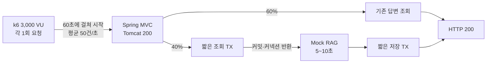

# 3,000 VU 커넥션 경계 부하 테스트

## 핵심 3줄

- k6에서 3,000 VU를 생성하고 각 VU가 한 번씩 요청하도록 하되, 요청 시작은 60초 동안 균등하게 분산했다.
- 기존 답변 60%와 5~10초 Mock RAG 신규 질문 40% 조건에서 3,000건 전부 성공했고, dropped iteration과 HTTP 실패는 모두 0건이었다.
- 외부 호출 동시 실행이 최대 167건일 때도 Hikari peak active는 2, pending과 acquisition timeout은 0이었다.

## 검증 목적

`TransactionTemplate`로 조회 트랜잭션과 저장 트랜잭션을 짧게 분리했을 때, 장시간 외부 RAG 호출 중 DB 커넥션이 풀로 반환되는지 검증했다.



## 테스트 계약

| 항목 | 설정 |
|---|---:|
| k6 executor | `per-vu-iterations` |
| VU | 3,000 |
| VU별 iteration | 1 |
| 요청 시작 분산 | 0~59.98초 |
| 전체 선택 | 기존 1,800건 / 신규 1,200건 |
| 신규 경로 | Mock RAG 5~10초 |
| 요청 timeout | 120초 |
| scenario max duration | 180초 |
| Tomcat max threads | 200 |
| Hikari maximum/minimum | 20/20 |

신규 payload는 유사도 검색 후보가 없는 단일 고유 숫자로 만들었다. 이 테스트의 목적은 자연어 검색의 확장성이 아니라, 신규 질문이 외부 RAG 경로를 탈 때 트랜잭션과 커넥션의 생명주기를 검증하는 것이다.

## 최종 결과

실행 ID: `20260830-vu3000-connection-boundary`

| 검증 항목 | 결과 |
|---|---:|
| 전체 iteration | 3,000 |
| 완료 / 중단 | 3,000 / 0 |
| 기존 선택 / 성공 / 실패 | 1,800 / 1,800 / 0 |
| 신규 선택 / 성공 / 실패 | 1,200 / 1,200 / 0 |
| Mock 호출 / 완료 / 오류 | 1,200 / 1,200 / 0 |
| HTTP 실패율 | 0% |
| dropped iteration | 0 |
| 총 실행 시간 | 69.65초 |
| 자동 실행 계약 | PASS |
| 자동 지표 계약 | PASS, 73 samples |

### 응답 시간

| 경로 | 평균 | p50 | p95 | 최대 |
|---|---:|---:|---:|---:|
| 전체 | 3.01초 | 18.53ms | 9.40초 | 10.01초 |
| 기존 답변 | 15.32ms | 14.71ms | 21.75ms | 126.35ms |
| 신규 RAG | 7.50초 | 7.43초 | 9.76초 | 10.01초 |

전체 p50이 짧은 이유는 요청의 60%가 기존 답변 경로이기 때문이다. 신규 경로 응답 시간은 의도적으로 설정한 Mock 지연 5~10초와 일치한다.

### 커넥션과 서버 자원

| 지표 | 관측값 |
|---|---:|
| Hikari peak active / max | 2 / 20 |
| Hikari peak pending | 0 |
| Hikari acquisition timeout 증가 | 0 |
| Hikari acquire 누적 시간 | 0.102초 / 6,170회 |
| MySQL peak threads connected | 21 |
| MySQL peak threads running | 4 |
| MySQL max-connection 오류 증가 | 0 |
| Mock peak in-flight | 167 |
| Tomcat peak busy / 설정 | 168 / 200 |
| JVM live threads peak | 215 |
| Process CPU peak | 11.12% |
| System CPU peak | 56.24% |
| JVM memory-used peak | 약 539MiB |

외부 호출이 최대 167건 동시에 대기할 때 Tomcat 스레드는 점유됐지만, Hikari active는 최대 2개였다. 즉 외부 호출 동안 조회 트랜잭션이 종료되고 DB 커넥션이 풀로 반환됐다는 관측 근거다.

## 실패 실험에서 확인한 경계

자연어 공통 토큰과 고유 숫자 토큰 8개를 섞은 신규 payload로 실행하면, 실행 중 저장된 질문들이 Full-Text Search 후보로 계속 누적됐다. 이후 요청마다 TF-IDF 계산 대상과 토큰 수가 증가해 CPU와 Tomcat 스레드가 포화됐다.

| Tomcat/Hikari | 성공 | 실패 | Hikari timeout | MySQL max 연결 오류 | 결론 |
|---|---:|---:|---:|---:|---|
| 200/20 | 2,311 | 689 | 0 | 0 | Tomcat 200 포화, 120초 timeout |
| 300/20 | 2,315 | 685 | 0 | 0 | 스레드 증설로 개선되지 않음 |

이 실패는 커넥션 풀 고갈이 아니라 유사도 검색 알고리즘과 CPU의 별도 병목이다. 따라서 최종 성공 결과를 자연어 유사도 검색 1,200건의 확장성 검증으로 해석하면 안 된다.

## 면접 답변

> k6에서 3,000 VU를 생성해 각 사용자가 한 번씩 요청하도록 하고, 요청 시작은 1분 동안 평균 초당 50건으로 분산했습니다. 기존 답변 60%, 5~10초 Mock RAG를 호출하는 신규 질문 40%로 구성했으며 3,000건이 모두 성공했습니다. 외부 호출 동시 실행이 최대 167건일 때도 Hikari active는 최대 2개, pending과 timeout은 0건이어서 외부 호출 전에 트랜잭션이 끝나고 커넥션이 반환되는 것을 확인했습니다.

### 표현 범위

`VU 3,000명 부하 테스트에서도 커넥션 풀 고갈 없이 안정적 처리`라고 쓸 수 있다. 다만 면접에서는 반드시 다음 조건을 함께 말한다.

- 3,000명이 같은 순간 요청한 것이 아니라 3,000 VU가 각 1회 요청했고 시작 시점을 1분 동안 분산했다.
- 안정적 처리는 3,000건 성공, HTTP 실패·drop·Hikari timeout·MySQL 최대 연결 오류가 모두 0이었다는 의미다.
- 신규 질문은 커넥션 경계를 격리 검증하기 위한 고유 payload였으며, 자연어 유사도 검색의 대규모 확장성은 별도 과제다.

## 재현 명령

```bash
LOAD_PROFILE=vu-3000-minute \
REQUEST_TIMEOUT=120s \
LOAD_TEST_TOMCAT_MAX_THREADS=200 \
LOAD_TEST_HIKARI_MAX_POOL_SIZE=20 \
LOAD_TEST_HIKARI_MIN_IDLE=20 \
RUN_ID=20260830-vu3000-connection-boundary \
VARIANT=refactored-vu3000 \
bash load-test/scripts/run-load-test.sh
```

원본 결과는 `load-test/results/20260830-vu3000-connection-boundary`에 저장했다.
